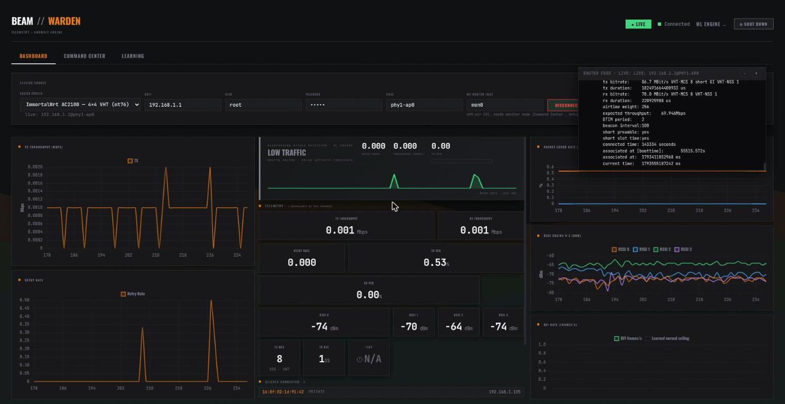
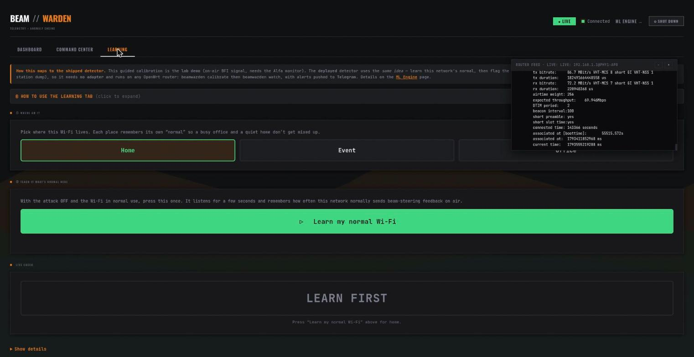
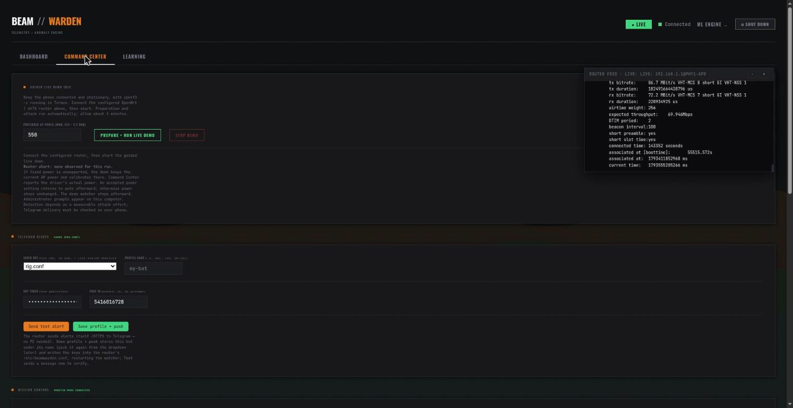
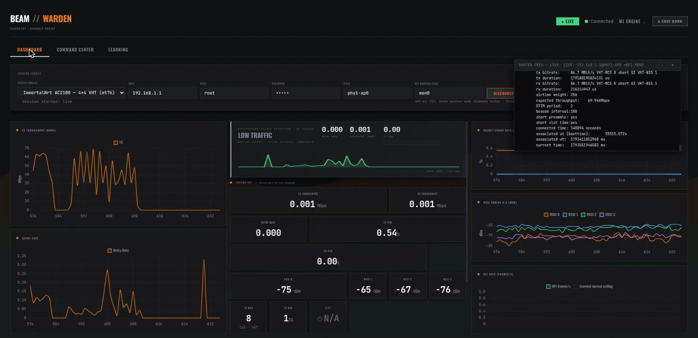

# Beam Warden — User Guide

A step-by-step manual for installing, calibrating, and running Beam Warden — the
adapter-free detector for Wi-Fi beamforming-feedback (BFI) spoofing attacks.

> **New here?** Beam Warden has **two parts**: a tiny **detector that runs on your
> router** (the product), and an optional **dashboard** you run on a laptop to watch
> it live and run the attack demo. You only need the router part to be protected.
> See [architecture](../README.md#how-it-runs--two-tiers) for the big picture.

---

## Contents

- [Part A — Protect a router (the product)](#part-a--protect-a-router-the-product)
  - [A1. What you need](#a1-what-you-need)
  - [A2. Install the package](#a2-install-the-package)
  - [A3. Point it at your Wi-Fi](#a3-point-it-at-your-wi-fi)
  - [A4. Learn your network (calibrate)](#a4-learn-your-network-calibrate)
  - [A5. Turn on protection](#a5-turn-on-protection)
  - [A6. What an alert looks like](#a6-what-an-alert-looks-like)
- [Part B — The dashboard (watch + demo)](#part-b--the-dashboard-watch--demo)
  - [B1. Launch & connect](#b1-launch--connect)
  - [B2. Read the live dashboard](#b2-read-the-live-dashboard)
  - [B3. Learn your network from the GUI](#b3-learn-your-network-from-the-gui)
  - [B4. Set up Telegram alerts](#b4-set-up-telegram-alerts)
  - [B5. Run the guided attack demo](#b5-run-the-guided-attack-demo)
- [Troubleshooting](#troubleshooting)
- [How confident should I be? (status & limits)](#how-confident-should-i-be-status--limits)

---

## Part A — Protect a router (the product)

This is all a defender needs. No laptop, no dashboard — the router detects locally
and alerts you over Telegram and a local log.

### A1. What you need

- An **OpenWrt** router you administer (SSH access).
- Packages `iw`, `curl`, `ca-bundle` (for the HTTPS Telegram push).
- 2 minutes of **normal, in-use Wi-Fi** to calibrate (see [A4](#a4-learn-your-network-calibrate)).

### A2. Install the package

- **Classic OpenWrt (opkg, ≤23.05):**
  ```sh
  opkg install beamwarden_*.ipk
  ```
- **Newer OpenWrt / ImmortalWrt (apk, ≥24.10 — no opkg yet):** drop the files in:
  ```sh
  tar xzf <(ar p beamwarden_*.ipk data.tar.gz) -C /
  chmod +x /usr/bin/beamwarden /etc/init.d/beamwarden /etc/beamwarden/on_alert
  ```

### A3. Point it at your Wi-Fi

Edit `/etc/beamwarden.conf`:

```sh
AP_IF=phy1-ap0          # your 5 GHz AP interface — find it with `iw dev`
MAC=aa:bb:cc:dd:ee:ff   # the client to protect; leave empty to watch all clients
```

Optional, for richer alerts: `AP_BSSID`, `CHANNEL`, `VICTIM_IP`, and your Telegram
`TELEGRAM_BOT_TOKEN` / `TELEGRAM_CHAT_ID` (from @BotFather).

### A4. Learn your network (calibrate)

The detector flags **deviations from your network's normal**, so it must learn that
normal first. Run this **once, with the attack OFF and the Wi-Fi under real use**
(someone streaming/downloading — not an idle link, because the detector only scores
loaded traffic):

```sh
beamwarden calibrate      # ~2 min; uses real traffic, learns retry/PER/throughput/RSSI
```

It prints `baseline learned: ...` and stores it. Re-run it whenever the network
environment changes materially (new location, new channel).

### A5. Turn on protection

```sh
/etc/init.d/beamwarden enable
/etc/init.d/beamwarden start
```

That's it — the watcher now scores every 2-second window against your baseline and
raises an alert on a sustained beamforming attack.

### A6. What an alert looks like

- **Telegram** — an incident report (severity, affected client, impact):
  > BEAM-WARDEN SECURITY ALERT - SEVERITY HIGH
  > Beamforming-injection attack on <router> targeting client aa:bb… (192.168.1.105).
  > Impact: downlink -82% (60->11 Mbps), retry 2.8x normal …
- **Local audit log** — one JSON line per alarm in `/etc/beamwarden/alerts.jsonl`
  (always written, even if Telegram is off — tail it, or feed it to a NOC collector).
- **System log** — `logread -e beamwarden -f`. Point your NOC's syslog at the router
  to ingest these centrally.

---

## Part B — The dashboard (watch + demo)

Optional. A laptop app that SSHes into the router to **visualise** the same telemetry
and to **run the attack demo**. It does not replace the router detector — the
router's own watcher is what alerts.

### B1. Launch & connect

```sh
.venv/bin/python tools/dashboard.py --mode live
```

Open **http://localhost:8080**. It **auto-connects** to your configured router
(mt76/SSH) on launch — no clicks needed.

### B2. Read the live dashboard



- **TX Throughput / Retry Rate** (left): the live link. Under a beamforming attack,
  throughput collapses and retry spikes.
- **Centre panel**: the ML verdict (`LOW TRAFFIC` / `NORMAL` / attack). This is a
  *local estimate* — the router's own watcher is the authority that sends alerts.
- **PER / RSSI chains / clients** (right): per-chain signal and associated devices.
- Top-right shows **Connected** and the live router feed.

### B3. Learn your network from the GUI



1. **Pick where this Wi-Fi lives** (Home / Event / Office) — each place keeps its own
   "normal", so a busy office and a quiet home don't get mixed up.
2. With the **attack off and the Wi-Fi in normal use**, press **"Learn my normal
   Wi-Fi"**. It listens for a few seconds and records this network's baseline.
3. The **Live check** then shows normal vs. anomalous in real time.

### B4. Set up Telegram alerts



In the **Telegram Alerts** panel (Command Center):

1. Pick a **Saved bot** from the dropdown, or choose **New…** to add one.
2. Enter a **Profile name** (e.g. `NOC`, `Lab`, `On-call`), the **Bot Token** (from
   @BotFather) and **Chat ID**.
3. **Send test alert** to verify it arrives on your phone.
4. **Save profile + push** — stores the bot under its name (pick it from the dropdown
   next time) *and* writes the keys into the router, restarting the watcher.

Saved bots work exactly like the router profiles — a reusable named list.

### B5. Run the guided attack demo

> This replays the real BeamCraft attack against the lab rig. It needs the attack
> adapter and the protected phone running `iperf3 -s`. Use only on your own equipment.

In **Command Center → Guided Live Demo**, click **Prepare + Run Live Demo** and
approve the desktop admin prompt. It calibrates a fresh baseline, generates load,
fires two short attack bursts, and you watch the detector react:



The **TX Throughput sawtooths from ~70 Mbps to near zero** on each burst, retry-rate
spikes track it, the detector raises the alarm, and the Telegram incident report lands
on your phone.

---

## Troubleshooting

| Symptom | Cause / fix |
|---|---|
| `[Errno 111] Connection refused` in the dashboard | The session is on the telnet transport. DISCONNECT → CONNECT the **mt76** profile on the Dashboard tab (a normal `--mode live` launch auto-connects; this only appears after switching profiles). |
| Guided demo aborts: `iperf3 … timed out` | The phone's `iperf3 -s` server is hung. On the phone (Termux): `pkill iperf3; iperf3 -s`. |
| Detector never alerts under a real attack | Make sure you **calibrated under load** (not idle), and that the client is actually associated. The detector only scores loaded windows. |
| No Telegram, but local log has the alert | The router has no internet (WAN) to reach `api.telegram.org`. Detection + the local `alerts.jsonl` still work. |
| `opkg: not found` | Your router uses `apk` (OpenWrt ≥24.10) — use the drop-in install in [A2](#a2-install-the-package). |

---

## How confident should I be? (status & limits)

The **usage above is real and verified** on the lab rig: install, calibrate,
detection, alarm, and Telegram delivery all work end-to-end.

For the **scientific standing** of the results — what's proven vs. what still needs a
larger confirmatory campaign (attack success rate, cross-network accuracy) — see the
honest status table and audit in the main
[README](../README.md#status-at-a-glance) and
[`docs/audit-2026-11-01/review.md`](audit-2026-11-01/review.md). Those caveats are
about *claims in a thesis*, not about whether the tool runs.
